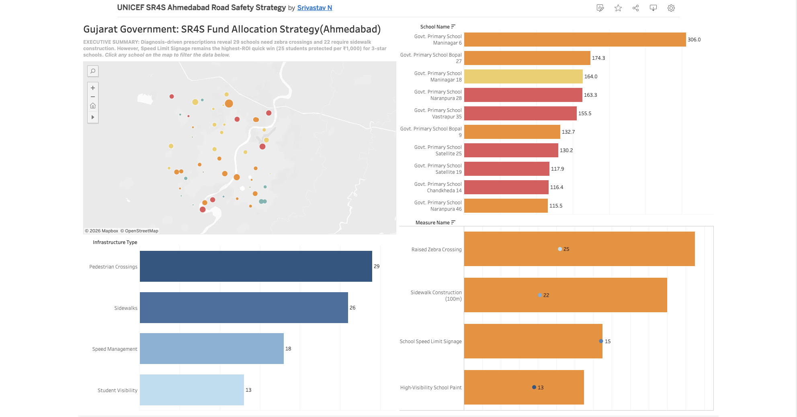
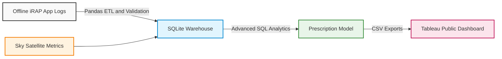

# UNICEF SR4S: Ahmedabad Road Safety & Fund Optimization Engine

  
  
  
  

  <strong>From Offline Field Audits to Government Fund Allocation: An End-to-End Data Engineering Pipeline</strong>

  

---

## Dashboard Preview
*(Click the image or link above to interact with the live, filterable dashboard)*

---

## Executive Summary
This project simulates a real-world UNICEF/iRAP data contract to optimize road safety infrastructure spending for the Gujarat Government. By engineering a robust pipeline around 50 Ahmedabad schools, integrating synthetic offline SR4S audit logs with satellite-derived ("Sky") traffic metrics, the model identifies critical safety gaps and prescribes diagnosis-driven countermeasures to maximize "students protected per 1,000 INR spent."

---

## Key Business & Engineering Insights
| Metric | Insight | Strategic Action |
| :--- | :--- | :--- |
| **Spatial Risk** | 1-star and 2-star schools cluster in high-traffic zones (e.g., Maninagar, Naranpura) with risk indices >150. | Prioritize immediate structural interventions (refuge islands, sidewalks) for these blackspots. |
| **City-Wide Gaps** | 29 schools scored <50/100 on Pedestrian Crossings, the highest failure rate across all 4 audited components. | Allocate Q1 procurement budget heavily toward raised zebra crossings. |
| **Cost-Benefit ROI** | Speed Limit Signage protects ~25 students per 1,000 INR, making it the ultimate "quick win" for 3-star schools. | Deploy signage city-wide immediately, while reserving heavy capital for 1-star structural upgrades. |
| **Data Integrity** | Simulated 30% offline audit sync delays without data loss, validating field collection resilience. | Implement automated post-sync validation scripts to flag GPS drift or missing fields instantly. |

---

## System Architecture

This project follows a modern, modular data pipeline designed for real-world field conditions:

